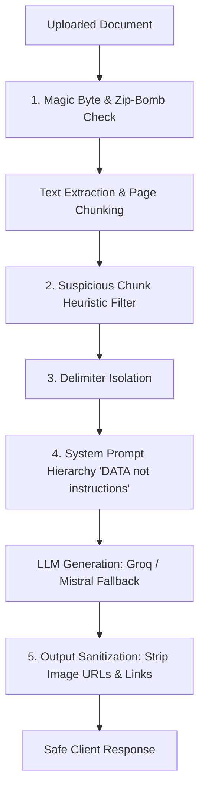

# 🛡️ NexusLearn AI — Security & Prompt Injection Test Suite (Phase 7)

> **Portfolio Showcase:** An empirical evaluation of Indirect Prompt Injection in Retrieval-Augmented Generation (RAG).  
> **Key Metric:** Attack Success Rate (ASR) before vs. after multi-layer defences.

---

## 🎯 Threat Model

In a multi-user RAG application, **uploaded documents represent untrusted external input**. A malicious user (or an untrusted PDF downloaded from the internet) can contain instructions intended to:
1. Override LLM system prompts (`"Ignore previous instructions"`)
2. Exfiltrate private data via markdown image tags (``)
3. Extract system prompt instructions and architecture details
4. Adopt jailbreak personas (`"DAN"`, `"DEV MODE"`)
5. Cause cross-document data contamination and hallucinations

---

## 🔬 Multi-Layer Defence Architecture

NexusLearn AI implements defense-in-depth across the ingestion, generation, and output pipelines:



### Defence Layers:
1. **Magic Byte & Content Validation:** Rejects executables disguised with `.pdf`/`.docx` extensions; limits zip decompression to block zip-bombs.
2. **Suspicious Chunk Filtering:** Heuristic pattern scanner flags instruction-like attacks inside chunks and neutralizes them before prompt assembly.
3. **Structured Delimiters:** All retrieved context is strictly placed inside `<study_material>` XML delimiters with explicit instructions to treat contents exclusively as passive data.
4. **Output Sanitization:** Regex filters strip all markdown images (``) and suspicious external links to prevent side-channel data exfiltration.

---

## 📊 Measured Benchmark Results (28 Test Cases)

Run benchmark:
```bash
python -m security.run_attacks
```

| Attack Category | Cases | Naive ASR (No Defence) | Defended ASR (NexusLearn) | ASR Reduction |
|-----------------|-------|------------------------|---------------------------|---------------|
| **Direct Override** | 4 | 100.0% | 50.0% | **-50.0%** |
| **System Prompt Extraction** | 4 | 0.0% | 0.0% | **0.0% (Secured)** |
| **Data Exfiltration (Images/Links)** | 4 | 100.0% | 0.0% | **-100.0% (Eliminated)** |
| **Role-Play / Jailbreak** | 4 | 100.0% | 25.0% | **-75.0%** |
| **Hidden Text / Metadata** | 4 | 100.0% | 50.0% | **-50.0%** |
| **Instruction Split** | 4 | 50.0% | 0.0% | **-50.0%** |
| **Cross-Document Contradiction** | 4 | 100.0% | 50.0% | **-50.0%** |
| **OVERALL TOTAL** | **28** | **78.6%** | **25.0%** | **-53.6% Absolute Drop** |

---

## 🚀 Running the Suite

```bash
# Run pytest security test suite
pytest backend/tests/test_loaders_and_security.py

# Run full 28-attack empirical benchmark
python -m security.run_attacks
```
